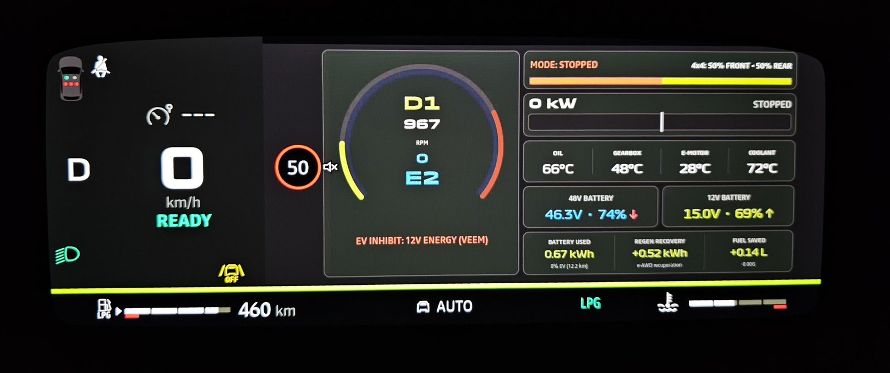
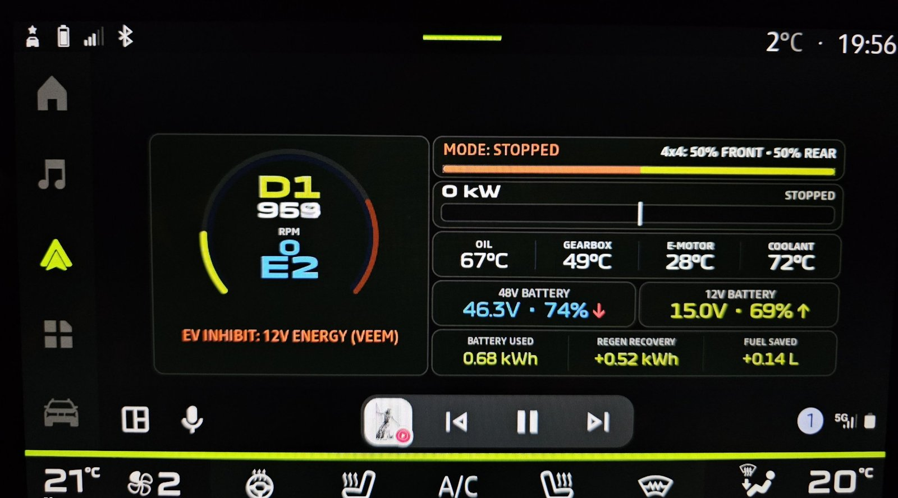

# Dacia Hybrid-G 150 Telemetry & Android Auto Cluster

Aplikacja Android / Android Auto dla samochodów **Dacia Hybrid-G 150 e-AWD** (Duster III / Bigster):

* **Zegary (Cluster Display):** telemetria napędu e-AWD, biegi DW23 i eRAD, wielosegmentowy pasek mocy
  (ICE + tylny e-Motor + HSG + rekuperacja), podział 4x4, temperatury, baterie 48V / 12V, bilans podróży,
  przyczyny blokady trybu EV.
* **Ekran środkowy (Infotainment):** ten sam zestaw kafelków z obrotomierzem (pełny ekran) lub bez (podzielony ekran Coolwalk).
* **Telefon:** konfiguracja w Jetpack Compose (elementy, kalibracja, diagnostyka OBD, podgląd na żywo) i tryb demo.

**[English version below](#english)**

### Zegary (ekran kierowcy)


### Ekran środkowy (Android Auto)


## Pobieranie i instalacja

Gotowy plik APK jest w zakładce **[Releases](https://github.com/N3j10/DaciaHybridCluster/releases/latest)**.

**Aplikację trzeba zainstalować przez [KingInstaller](https://github.com/fcaronte/KingInstaller).**
Android Auto pokazuje tylko aplikacje zainstalowane ze Sklepu Play. Po zwykłej instalacji pliku APK
(np. z menedżera plików) aplikacja zainstaluje się na telefonie, ale **Android Auto jej nie zobaczy**.
KingInstaller instaluje APK tak, jakby pochodził ze Sklepu Play.

1. Pobierz `DaciaHybridCluster-vX.Y.Z.apk` z [ostatniego wydania](https://github.com/N3j10/DaciaHybridCluster/releases/latest) i skopiuj go na telefon.
2. Zainstaluj [KingInstaller](https://github.com/fcaronte/KingInstaller/releases) na telefonie.
3. W KingInstaller wybierz pobrany plik APK i zainstaluj go.
4. Sparuj adapter vLinker w ustawieniach Bluetooth telefonu, wybierz go w aplikacji i podłącz telefon do Android Auto.

---

## Architektura

```
com.dacia.hybridcluster/
├── DaciaApp.kt                    # Inicjalizacja przy starcie procesu (także gdy uruchamia go samo Android Auto)
├── MainActivity.kt                # UI telefonu
├── model/
│   ├── TelemetryData.kt           # Model telemetrii (bez pól, których nic nie wypełniało)
│   ├── HybridMode.kt              # Enumy: tryb napędu + przyczyny blokady EV
│   ├── UiConfig.kt                # Konfiguracja zapisywana jako JSON (Gson) + migracja ze starych kluczy
│   └── AppStrings.kt              # PL / EN (także nazwy trybów i blokad)
├── engine/
│   ├── PidDecoders.kt             # Skalowania PID-ów (zweryfikowane z DDT4All ecu_final.zip) + RawReadings
│   ├── PowertrainCalculator.kt    # Bilans mocy, tryby, podział 4x4 – czysta logika, bez I/O
│   └── TripEnergyTracker.kt       # Trip: przeżywa zerwanie BT i restart procesu, nowy po 4 h przerwy
├── obd/
│   ├── ElmLink.kt                 # Interfejs transportu ELM
│   ├── StreamElmLink.kt           # Transport na strumieniach – wątek czytający + kolejka odpowiedzi
│   ├── BluetoothElmLink.kt        # Połączenie SPP z vLinkerem
│   ├── ObdProtocol.kt             # Inicjalizacja STN/ELM, STPX, adresowanie ECU, polityka ponawiania PID-ów
│   ├── PidPoller.kt               # Harmonogram: pętla szybka / średnia / wolna
│   ├── DemoSource.kt              # Dane trybu demo (osobny trip)
│   ├── ObdLogger.kt               # Log w tle z buforem i rotacją (8 MB)
│   └── ObdManager.kt              # Orkiestracja: jedna korutyna na wątku "obd-io"
└── car/
    ├── HybridCarAppService.kt     # CarAppService (NAVIGATION + FEATURE_CLUSTER)
    ├── HybridCarSession.kt        # Ekran środkowy + "trasa-widmo" uruchamiająca klaster
    ├── ClusterCarSession.kt       # Sesja zegarów
    ├── TelemetryRendererBase.kt   # Wspólne sekcje rysowania obu ekranów, rysowanie bez alokacji
    ├── ClusterSurfaceRenderer.kt  # Układ zegarów
    ├── InfotainmentSurfaceRenderer.kt # Układ ekranu środkowego
    └── InfotainmentScreens.kt     # Szablony Android Auto (menu, elementy, podgląd)
```

Sterowniki (29-bit CAN, ATSP7): EMS3253 `18DA15F1`, eRAD `18DAE5F1`, DW23 `18DA18F1`, BMS Sunwoda `18DA92F1`, DCDC `18DADDF1`.

---

## Budowanie

```
build_apk.bat          # APK debug -> DaciaHybridCluster.apk
build_apk.bat test     # najpierw testy JVM i symulacja na logach, potem APK
install_phone.bat      # instalacja przez ADB
```

`build_apk.bat` używa lokalnego Gradle 8.10.2 (zgodnego z AGP 8.7.2). Wrapper (`gradlew`) wskazuje na Gradle 9.6.0
ustawiony przez Android Studio – z AGP 8.7.2 może nie działać.

## Testy i symulacja na danych z auta

Testy JVM (`app/src/test`) nie potrzebują telefonu ani auta:

* `PidDecodersTest`, `ObdProtocolTest`, `StreamElmLinkTest`, `TripEnergyTrackerTest`, `ConfigJsonTest`;
* `ReplayTest` – odtwarza logi `*.log` z katalogu projektu (lub `DACIA_LOG_DIR`) przez wirtualny adapter ELM
  i sprawdza:
  * że nowy kod liczy **dokładnie** to samo co pętla sprzed refaktoru (`LegacyEngine` – kopia starego kodu),
  * fizyczną spójność (brak NaN, ujemnych mocy, napędu i rekuperacji naraz, suma mocy, 4x4 = 100%),
  * że obroty są zawsze aktualne i trip nie spada przy ponownym połączeniu.

Raport z symulacji: uruchom `SimulationReportKt.main` (w Android Studio: zielona strzałka przy `fun main`).

## Uruchomienie w aucie / na DHU

1. Sparuj vLinker w ustawieniach Bluetooth telefonu, wybierz go w aplikacji (wyłącz tryb demo).
2. Podłącz telefon do Android Auto. Zapamiętany adapter łączy się automatycznie – także wtedy,
   gdy aplikacja na telefonie nie była otwierana.
3. Test bez auta: `run_dhu.ps1` (DHU z ekranem zegarów).

---

<a id="english"></a>
## English

Android / Android Auto app for **Dacia Hybrid-G 150 e-AWD** cars (Duster III / Bigster):

* **Cluster display:** e-AWD drivetrain telemetry, DW23 gearbox and rear eRAD gears, multi-segment power bar
  (engine + rear e-motor + HSG + regeneration), 4x4 split, temperatures, 48V / 12V batteries, trip energy balance,
  reasons why EV mode is blocked.
* **Centre screen (infotainment):** the same tiles, with a tachometer (full screen) or without it (Coolwalk split screen).
* **Phone:** settings in Jetpack Compose (elements, calibration, OBD diagnostics, live preview) and a demo mode.

Screenshots from the car: [cluster](docs/zegary.jpg) and [centre screen](docs/ekran_srodkowy.jpg) (shown at the top of this page).

### Download and installation

The ready-to-install APK is in **[Releases](https://github.com/N3j10/DaciaHybridCluster/releases/latest)**.

**The app must be installed with [KingInstaller](https://github.com/fcaronte/KingInstaller).**
Android Auto only shows apps installed from the Play Store. If you install the APK the usual way
(e.g. from a file manager), the app will install on the phone, but **Android Auto will not see it**.
KingInstaller installs the APK as if it came from the Play Store.

1. Download `DaciaHybridCluster-vX.Y.Z.apk` from the [latest release](https://github.com/N3j10/DaciaHybridCluster/releases/latest) and copy it to the phone.
2. Install [KingInstaller](https://github.com/fcaronte/KingInstaller/releases) on the phone.
3. In KingInstaller, pick the downloaded APK and install it.
4. Pair the vLinker adapter in the phone's Bluetooth settings, select it in the app and connect the phone to Android Auto.

### Building

`build_apk.bat` builds a debug APK (`DaciaHybridCluster.apk`), `build_apk.bat test` runs the JVM tests and the
replay simulation on recorded drive logs first. `wydaj_release.bat` builds, pushes and publishes a GitHub release.
